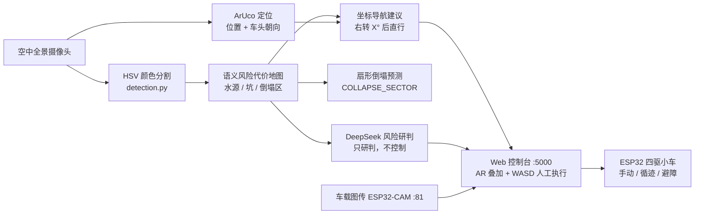
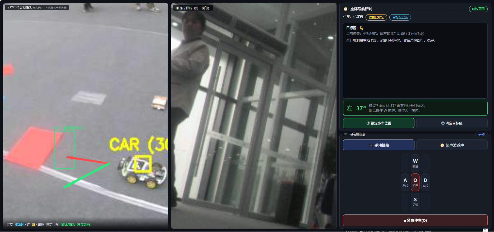
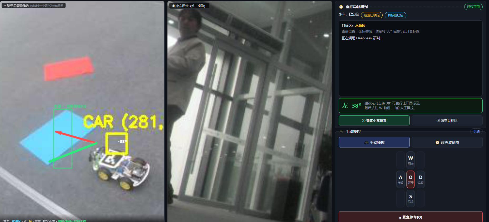
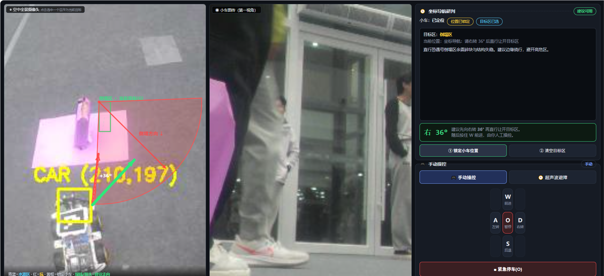
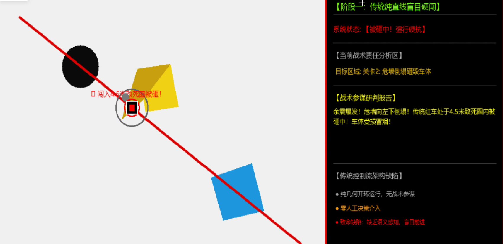
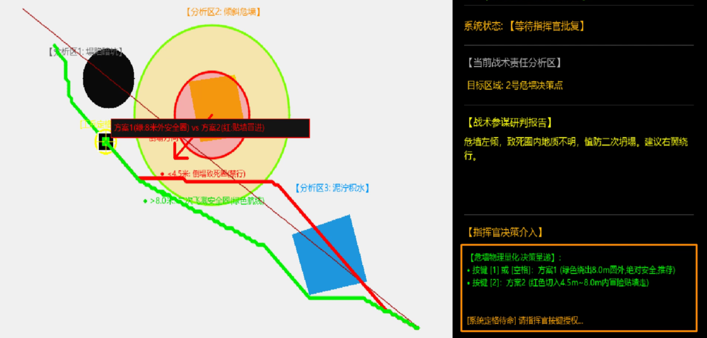

# earthquake-rescue-system

[](https://github.com/zhaoqingyu76-cell/earthquake-rescue-system/actions/workflows/ci.yml)

基于空地协同与语义风险代价图的震后救援路径研判系统。

空中全景摄像头俯拍现场，识别水源、坑洞、建筑倒塌区三类语义风险并建成代价地图；系统算出“右转 X° 后直行”的坐标导航建议，由搜救人员用 WASD 手动执行。**人工在回路、零自动行驶**——电脑端只给建议和研判，绝不自动开车。

## 系统定位

- **空地协同**：空中全景摄像头负责大范围感知，小车（ESP32 四驱）负责近距执行，车载图传（ESP32-CAM）负责近距兜底。
- **语义风险代价地图**：不是只画一张图，而是把现场按语义分成水源、坑洞、倒塌区三类风险，每类有自己的警戒规则，导航建议绕着风险走。
- **坐标导航，而非自动驾驶**：系统用 ArUco 码算出小车位置与车头朝向，给出转向角建议；转向和行驶全程由人工 WASD 完成。

## 架构数据流



> Web 主流程全程人工在回路、零自动行驶。`rescue_controller.py` 是离线备用的 OpenCV 窗口版控制器，不参与 Web 主流程。

## 创新点

- **语义风险代价地图 + 坐标导航**：现场按语义分成水源、坑、倒塌区三类风险，每类有自己的警戒规则，导航建议绕着风险走，而不是只画一张图。
- **扇形倒塌预测**：倒塌区锁定后画红色扫描扇形，预测倾倒覆盖范围，提前标出禁行区。
- **人在回路 + 大模型研判**：DeepSeek 只给研判、不控制；小车进入危险区自动停车后，也要搜救人员确认才继续。

## 六大功能模块

| # | 模块 | 做了什么 |
|---|---|---|
| 1 | 空中全景感知识别 | 全景摄像头俯拍，HSV 颜色分割识别三类地形 + ArUco 码定位小车位置与朝向；小车自身区域从判定中剔除，避免车身误判；自带去噪（面积门槛、形状过滤、同类合并、跨帧稳定、场地 ROI） |
| 2 | 坐标导航 | 按“锁定小车 → 点选目标区”流程，算出建议转向角（右转 X° 后直行即可让开目标区），前端叠加 AR 箭头与走向提示，人工确认后执行 |
| 3 | 扇形倒塌检测 | 锁定紫色倒塌区后，以其中心为顶点画红色预测扇形（开口约 94°），标出墙体倾倒可能覆盖的范围 |
| 4 | 三模式操控 | 手动 / 循迹 / 避障三种模式切换；WASD 按住动、松开停 |
| 5 | 车载图传近距兜底 | 自动探测车载图传流（`:81/stream`），近距画面同样做 HSV 检测，危险占比超阈值即提示，断流自动重连 |
| 6 | DeepSeek 风险研判 | 对锁定的危险区做战术研判，只出建议不控制；无 Key、断网或超时时返回本地降级文案，不影响控制主流程 |

## 数据流

```
全景摄像头
  → HSV 识别三类地形 + ArUco 定位小车位置/朝向
  → 算转向角建议，前端叠加 AR 箭头
  → 人工确认 → WASD 发 HTTP 指令 → 小车执行
  → 小车进入 2cm 警戒框 → 自动停车，DeepSeek 研判，人工决定绕行或直穿
车载图传（:81/stream）→ 近距 HSV 检测兜底
```

## 颜色约定

| 颜色 | 含义 | HSV 范围（`config.py`） |
|---|---|---|
| 青蓝 | 水源区 | H 70–105 |
| 红 | 坑洞 | H 0–12 |
| 紫 | 建筑 / 倒塌区 | H 120–170 |
| 红（半透明扇形） | 倒塌预测扫描区 | 见 `COLLAPSE_SECTOR` |

## 仓库结构

```
earthquake-rescue-system/
├── firmware/                 # 硬件端：ESP32 智能小车固件（Arduino）
│   ├── SmartCar_System/      # Arduino 工程目录（目录名须与 .ino 同名）
│   │   ├── SmartCar_System.ino   # 主程序：初始化、模式调度
│   │   ├── config.h              # 引脚与控制参数（本地配置见 config.example.h）
│   │   ├── SpeedDrive.cpp/.h     # 电机驱动与测速
│   │   ├── TraceControl.cpp/.h   # 循迹控制（5 路传感器）
│   │   ├── AvoidControl.cpp/.h   # 避障控制（超声波 + 舵机扫描）
│   │   └── WebHandler.cpp/.h     # Web 控制台（AP + STA 混合模式）
│   └── camera/               # 车载图传摄像头（ESP32-CAM，GC2145）
│       └── camera_web.html   # 图传 Web 页面源码（:80 控制页、:81/stream）
├── software/                 # 软件端：救援指挥上位机（Python + Flask）
│   ├── web_server.py         # Flask 控制台：全景画面 + AR 导航 + WASD 手动控制
│   ├── rescue_controller.py  # OpenCV 窗口版控制器（备用；两阶段流程）
│   ├── car.py                # 小车 HTTP 控制层
│   ├── detection.py          # 颜色分割检测 + ArUco 小车定位
│   ├── decision.py           # 危险判定：进 2cm 警戒框停车研判，否则直行
│   ├── deepseek.py           # DeepSeek 风险研判（无 Key 时本地降级）
│   ├── config.py             # 现场配置（IP、摄像头、检测参数；密钥只走环境变量）
│   ├── web/index.html        # 控制台前端页面
│   ├── demo/                 # 全流程概念演示（仿真，不接硬件）
│   │   └── sim_tactical_brain_cartoon.py
│   └── tools/                # 摄像头编号探测、HSV 颜色标定工具
├── docs/
│   ├── hardware.md
│   ├── software.md
│   └── setup.md
└── .github/workflows/ci.yml  # CI：Python 语法检查 + ESP32 固件编译检查
```

## 实际运行

### Web 控制台（真实场地运行）

左：空中全景摄像头俯拍（HSV 识别 + ArUco 定位 + AR 导航箭头）；中：小车第一视角（ESP32-CAM 图传兜底）；右：坐标导航研判面板。


*目标区：坑（红纸）。建议“先向左转 37° 再直行让开目标区”；研判：直行协调易塌陷卡滞，余震下风险高，建议边缘绕行、稳妥。*


*目标区：水源区（蓝纸）。正在调用 DeepSeek 研判；建议“先向左转 38° 再直行让开目标区”。*


*目标区：倒塌区（紫纸）。红色扇形为倒塌预测覆盖区（倒塌方向向下）；建议“先向右转 36° 再直行让开目标区”；研判：直行恐遇倒塌余震碎块与结构失稳，建议边缘绕行，避开危区。*

### 全流程概念演示（仿真，不接硬件）


*阶段一：传统纯直线（红线）无视地形，闯入危墙 4.5 米致死圈被砸中，系统状态【被砸中！强行硬抗】。*


*阶段二：本系统接管，方案 1（绿线）绕出 8.0 米外安全圈、绝对安全，方案 2（红线）切入 4.5~8.0 米内冒险贴墙走，等指挥官按 [1]/[2] 批复。*

## 快速开始

### 1. 硬件端（小车）

1. 用 Arduino IDE 打开 `firmware/SmartCar_System/SmartCar_System.ino`，安装 ESP32 开发板支持。
2. 复制 `firmware/SmartCar_System/config.example.h` 为同目录下的 `config.h`，按实际接线确认引脚。
3. 在 `firmware/SmartCar_System/WebHandler.cpp` 里填入**你自己的**手机热点名称和密码（不要提交真实密码，见下）。
4. 编译并烧录，打开串口监视器，记下小车在 STA 模式下的本机 IP。

### 2. 软件端（上位机）

```bash
cd software
python -m venv .venv
# Windows: .venv\Scripts\activate
# macOS/Linux: source .venv/bin/activate
pip install -r requirements.txt

# 1) 填配置：复制 config.example.py 为 config.py，
#    把串口读到的 ESP32 IP、车载图传 IP 填进去
# 2) DeepSeek 研判（二选一）：设环境变量 export DEEPSEEK_API_KEY="YOUR_DEEPSEEK_API_KEY"，
#    或者启动时直接输入 Key（程序会问你，直接回车就是不用）。不设也能跑，会用本地降级文案
python web_server.py
# 浏览器访问 http://<电脑IP>:5000
```

操作顺序：① 锁定小车位置 → ② 点选目标区 → 按建议转向角 WASD 手动行驶。

第一次跑之前，先用 `tools/probe_camera.py` 确认全景摄像头的编号，再填到 `config.py` 的 `CAMERA_ID`。

详细步骤见 [docs/setup.md](docs/setup.md)。

## 三种模式

| 模式 | 说明 |
|---|---|
| 手动 | WASD / 网页按钮直接控制小车，按住动、松开停 |
| 循迹 | 5 路传感器沿黑线行驶 |
| 避障 | 超声波 + 舵机扫描，遇障减速、转向或后退脱困 |

## 现场标定指南

这些参数每次到现场都可能要调，都集中在 `software/config.py`：

| 参数 | 调什么 |
|---|---|
| `CAR_IP` / `ONBOARD_IP` | 小车与图传设备的局域网 IP（从串口监视器读） |
| `CAMERA_ID` | 全景摄像头编号（`tools/probe_camera.py` 确认） |
| `WATER_LOW/HIGH`、`PIT_LOW/HIGH`、`COLLAPSE_LOW/HIGH` | 三类地形的 HSV 范围（`tools/probe_color.py` 标定） |
| `COLLAPSE_SECTOR` | 倒塌预测扇形的开口角与半径 |
| `DANGER_RADIUS_PX` | 危险区警戒框外扩像素（对应 2cm） |
| `FLIP` | 全景画面是否镜像翻转 |

## 安全约束

- **锁定小车才导航**：ArUco 码没稳定识别到之前，系统不给出导航建议、不发任何行驶指令。
- **风险决策需人工授权**：小车进入警戒区自动停车后，绕行还是直穿由搜救人员决定，系统只给建议。
- **按住动、松开停**：WASD 与网页按钮都是点动控制，松开即停。
- **Web 主流程零自动行驶**：电脑端永远不自动行驶、不自动转向。`rescue_controller.py` 是备用的 OpenCV 窗口版控制器，不在主流程里。

## 环境要求

- 硬件：ESP32 小车 + ESP32-CAM 图传 + 全景摄像头，手机热点组网。
- 软件：Arduino IDE（含 ESP32 开发板支持）+ Python 3.12，依赖见 `software/requirements.txt`（Flask、opencv-python、numpy、requests、pillow）。

## 安全提醒

**不要把真实密钥、密码提交到这个仓库。**

- `firmware/SmartCar_System/WebHandler.cpp` 里的热点名称/密码：本地填写，不要提交。
- `software/config.py` 里的 DeepSeek Key：只从环境变量 `DEEPSEEK_API_KEY` 读取，或者启动时输入，不要写进代码。
- 现场 IP（小车、图传）每次联网都可能变，填在本地的 `config.py` / `.env` 里；`.env` 已在 `.gitignore` 中忽略。
- 如果你曾经把带真实密钥的代码推到过公开仓库，**只删文件不够**，历史提交里还能找到：请先去对应平台作废/轮换那个密钥，再重写历史或删库重建。

## License

Apache-2.0，见 [LICENSE](LICENSE)。
