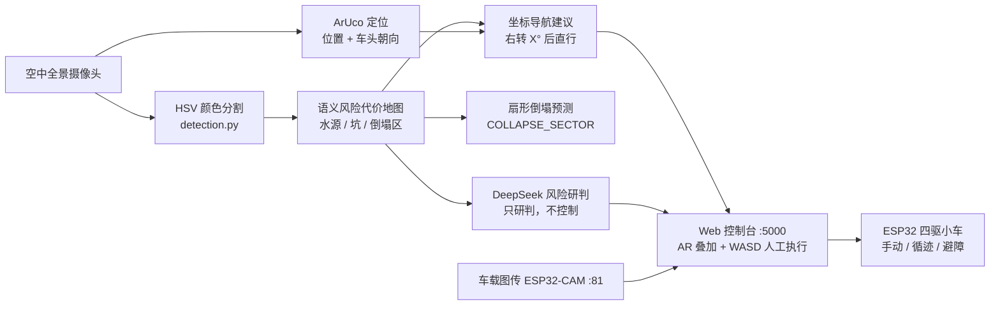

# 软件端（software/）

救援指挥上位机，Python + Flask + OpenCV。定位：空地协同语义风险代价地图 + 坐标导航；Web 主流程人工在回路、零自动行驶。

## 文件

| 文件 | 作用 |
|---|---|
| `web_server.py` | Flask 控制台（入口）：全景画面 + AR 导航叠加、小车第一视角、战术决策、WASD 手动控制，`http://<电脑IP>:5000` |
| `rescue_controller.py` | OpenCV 窗口版控制器（离线备用，不参与 Web 主流程）：ArUco 定位 → 两阶段流程；Web 主流程始终人工在回路、零自动行驶 |
| `car.py` | 小车 HTTP 控制层：`/cmd`、`/mode`，方向去重与点动 |
| `detection.py` | 颜色分割检测（水源/坑/倒塌区）+ ArUco 小车定位与朝向；自带去噪：面积门槛、形状过滤、同类合并、每类上限、跨帧稳定、场地 ROI（见下） |
| `decision.py` | 危险判定：小车进入色纸警戒框 → 停车研判，否则直行；定位丢失也停车 |
| `deepseek.py` | DeepSeek 战术研判；无 Key / 断网 / 超时时返回本地降级文案，不影响控制 |
| `config.py` | 现场配置：IP、摄像头、检测与控制参数（本地文件，不进 Git；用 `config.example.py` 起步） |
| `web/index.html` | 控制台前端（`web_server.py` 从 `web/index.html` 加载） |
| `demo/sim_tactical_brain_cartoon.py` | 全流程概念演示（仿真版，不接硬件）：阶段一传统红线盲闯失败 → 阶段二本系统绿线 A* 绕行救人，见 `software/demo/README.md` |
| `tools/probe_camera.py` | 摄像头编号探测（0~5 循环预览） |
| `tools/probe_color.py` | HSV 颜色标定（点选紫色纸，打印 H/S/V 范围） |
| `tests/` | 单测（pytest）：检测去噪 + 决策触发条件，用合成画面跑，不用真摄像头 |

## 数据流



## 检测去噪（detection.py）

USB 摄像头一接上就"什么都测到"时，先看这里。检测流水线：

```
HSV 分割 -> 形态学开/闭 -> 找轮廓 -> 面积过滤 -> 形状过滤
        -> 同类合并 -> 每类取大 -> 跨帧稳定 -> 输出
```

| 手段 | 拦什么 | 参数（config.py） |
|---|---|---|
| 面积门槛 | 碎点、反光、小斑点 | `MIN_ZONE_AREA`（默认 800） |
| 形状过滤 | 细长条（线缆、桌边反光）、空心框 | `ZONE_MAX_ASPECT`、`ZONE_MIN_SOLIDITY` |
| 同类合并 | 光照不均把一张纸劈成几块 | `ZONE_MERGE_PX`（框间距小于此值就合并） |
| 每类上限 | 每种颜色只留面积最大的几个区 | `ZONE_MAX_PER_KIND`（默认 6） |
| 跨帧稳定 | 单帧闪现的斑点 | `ZONE_PERSIST_FRAMES`（默认 2）、`ZONE_TRACK_DIST_PX` |
| 场地 ROI | 场地外的地面、墙边杂物 | `ROI = (x, y, w, h)`，None = 全画面 |

现场调参顺序：先跑 `tools/probe_camera.py` 确认拿到的是全景摄像头，再跑 `tools/probe_color.py` 在当前光线下重标 HSV，最后按色纸在画面里的实际大小定 `MIN_ZONE_AREA`、按场地范围填 `ROI`。

**HSV 现场标定方法（`probe_color.py`）：别只点一个点就写回。**

单次点选给出的只是那一个像素的邻域范围（常常只有 1~2 个单位宽），直接写回会让检测变得极脆——纸面亮处、暗处、阴影、反光处的 HSV 都不一样，大半张纸会落到范围外。正确做法：

1. 在同一张纸上点 5~8 个点：中心、四边、一个阴影处、一个反光亮处；
2. 取所有点的 H、S、V 最小值和最大值；
3. 再放宽：H 两边各放宽 8~10，S 下限减 20~30，V 下限减 30~50；
4. 在标注画面里验证：整张纸都被框住，背景没被误框。

例如某次多点采样得到 H 135~148、S 85~160、V 190~245，写回的就是 `COLLAPSE_LOW=(125, 60, 140)`、`COLLAPSE_HIGH=(158, 255, 255)`——而不是某一个点的窄范围。

## 工作流程

1. 全景摄像头俯拍现场，`detection.py` 定位小车（顶部 ArUco 码）和危险区。
2. 小车进入危险区警戒框时停车，`deepseek.py` 给出研判建议。
3. 搜救人员决定绕行还是直穿；系统只给建议和 AR 走向提示，**不自动开车**（`web_server.py` 版）。
4. 小车第一视角来自车载图传（`:81/stream`），与控制接口是两个独立地址，分别填在 `config.py` 里。

## 依赖

见 `software/requirements.txt`：Flask、opencv-python、numpy、requests。
