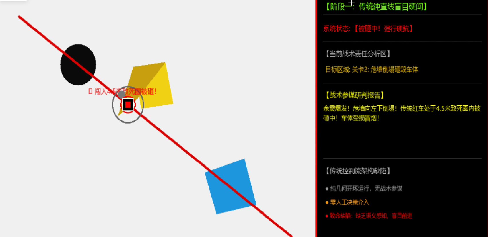
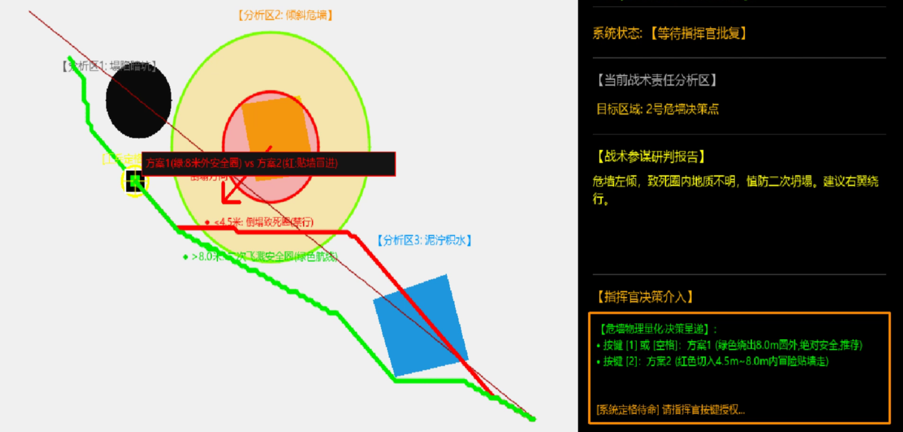

# demo/

全流程项目概念演示代码（仿真演示版，不接真实硬件）。

## 这是什么

`sim_tactical_brain_cartoon.py`（1063 行）：一个独立运行的战术指挥中心仿真演示，
用合成场景把“传统做法 vs 本系统”完整跑一遍，适合比赛答辩、展演时放给别人看。

- **阶段一：传统直线盲闯（红线）**——纯直线寻路，无视地形：
  碾进暗坑、闯入危墙 4.5m 致死圈、涉水打滑陷车。
- **阶段二：本系统接管（绿线）**——A* 规划绕开危险区，人在回路研判，
  最终抵达受困人员坐标，任务达成。

场景里有暗坑区、危墙区（致死圈 <4.5m、8m 外安全走廊）、泥泞积水区；
DeepSeek 战术研判有 Key 时在线调用，无 Key 时用本地降级文案。

## 运行

```bash
# 在 software/ 下装好依赖（已包含 Pillow）
pip install -r requirements.txt

# （可选）DeepSeek Key：export DEEPSEEK_API_KEY="YOUR_DEEPSEEK_API_KEY"，或者启动时直接输入（程序会问你，回车跳过）
python demo/sim_tactical_brain_cartoon.py
```

- 阶段一结束按 **Enter 回车** 切换到阶段二
- **R** 重新演示，**F** 切换全屏，**ESC** 退出
- 中文字体默认读 `C:/Windows/Fonts/msyh.ttc`，没有时用黑体，缺失则用默认字体；
  所以这个演示目前主要在 Windows 上跑。

## 注意

- 这是**演示/仿真**，不连小车、不读摄像头、不发控制指令；
  真实硬件流程见 `../web_server.py` 和 `../rescue_controller.py`。
- DeepSeek Key 只从环境变量读取，文件里不要再写死 Key。

## 运行截图


*阶段一：传统纯直线（红线）无视地形，闯入危墙 4.5 米致死圈被砸中，系统状态【被砸中！强行硬抗】。*


*阶段二：本系统接管，方案 1（绿线）绕出 8.0 米外安全圈、绝对安全，方案 2（红线）切入 4.5~8.0 米内冒险贴墙走，等指挥官按 [1]/[2] 批复。*
